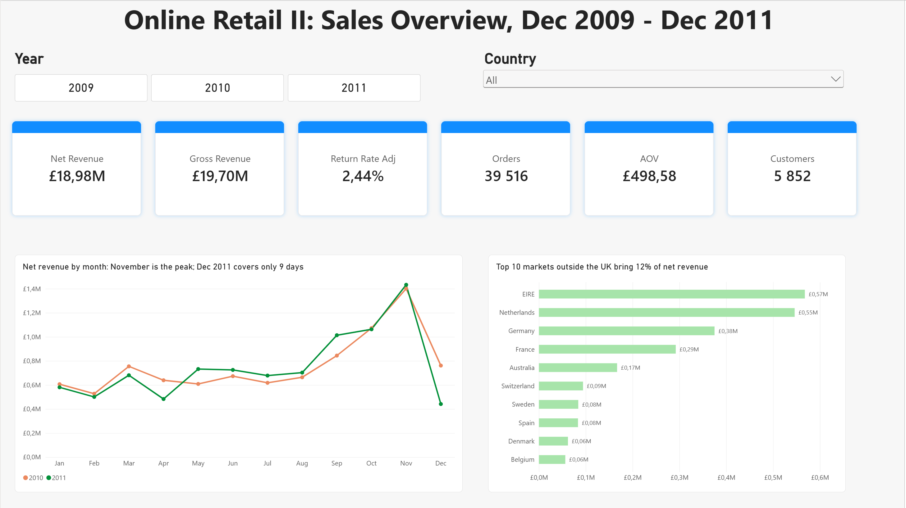
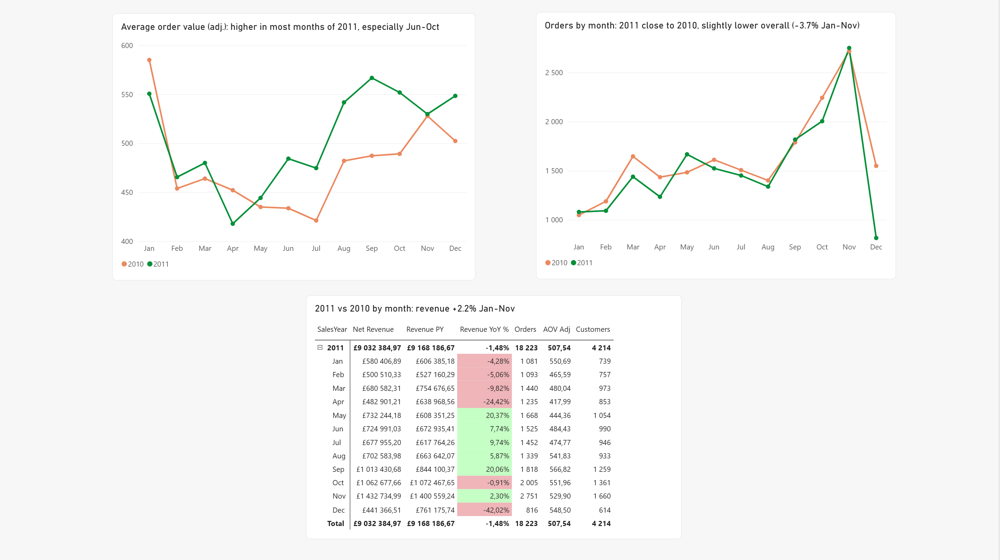
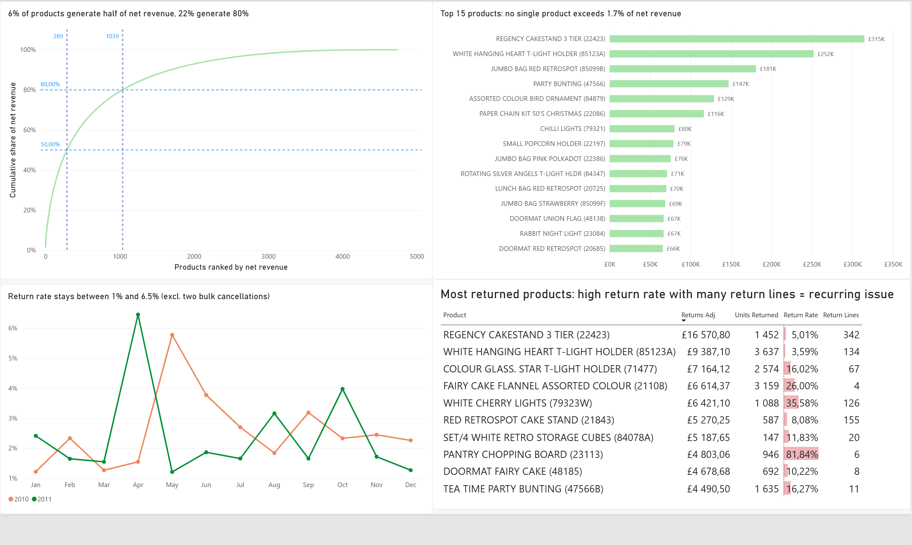
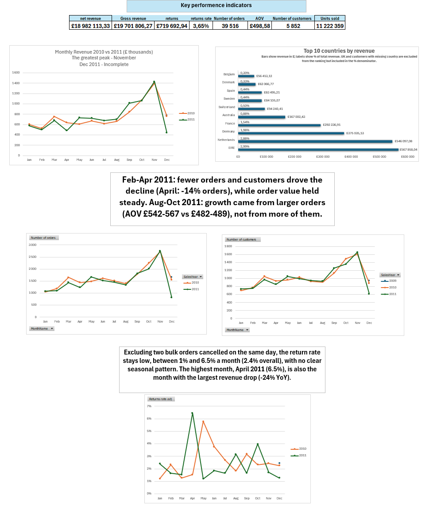

# Online Retail II: Sales Analysis (SQL Server, Excel, Power BI)

End-to-end analysis of a UK online retailer's transactions: messy raw data, cleaning and modelling in SQL, pivot-based analysis in Excel, and an interactive Power BI dashboard.

> **Status:** done. SQL model, Excel analysis and Power BI dashboard are complete.



## Business context

The company is a UK-based online retailer selling giftware, and many of its customers are wholesalers. Management wants to know:

1. How much the business really earns once returns are taken into account.
2. How revenue changes over time, and whether 2011 was better than 2010.
3. Which markets and which products the revenue depends on.
4. What in the data limits these answers.

The raw export is not usable as it is: it mixes sales with returns, stock adjustments, fees and test entries, and the two source files overlap. This project first builds a trustworthy data model, then answers the questions in Excel and Power BI.

## Dataset

- **Source:** [Online Retail II, UCI Machine Learning Repository](https://archive.ics.uci.edu/dataset/502/online+retail+ii)
- **Period:** 01.12.2009 - 09.12.2011 (December 2011 covers only 9 days)
- **Size:** 1,067,371 transaction lines in two sheets (525,461 + 541,910 rows); 1,044,932 lines after removing cross-file duplicates
- **Columns:** Invoice, StockCode, Description, Quantity, InvoiceDate, Price, Customer ID, Country

## Tools

| Tool | Used for |
|---|---|
| SQL Server (SSMS) | import, type conversion, data quality audit, cleaning, star schema |
| Excel | pivot tables on the Data Model, DAX measures, charts |
| Power BI | dashboard, DAX measures |

## Project structure

```
sql/
  01_staging_and_data_quality.sql   import, typing, data quality audit (done)
  02_cleaning.sql                   duplicates, stg_retail_dedup (done)
  03_star_schema.sql                row_type, dim_customer, dim_product, dim_date, fact_sales (done)
excel/                              Dashboard, Trend, Countries, Products, Returns, Notes
powerbi/                            3-page report: Overview, Sales drivers, Products & Returns
images/                             screenshots used in this README
README.md
```

## Approach so far

1. **Staging:** both files imported as text (`nvarchar`) and combined into `stg_retail_raw`, with a `source_file` column. Importing as text avoids silent loss of dirty values.
2. **Typing:** columns converted once into `stg_retail_typed`, with validation of every conversion.
3. **Audit:** size of each data quality issue measured on `stg_retail_typed` (before deduplication) and investigated row by row.
4. **Cleaning:** cross-file duplicates removed into `stg_retail_dedup`; the row count and the absence of remaining cross-file duplicates were validated.
5. **Row classification:** every line gets a `row_type` (see below), so that sales, returns and non-sales entries are never mixed.
6. **Star schema:** three dimensions and one fact table built from `stg_retail_dedup`. The fact table holds sales and cancellations, so revenue can be reported net of returns.
7. **Excel analysis:** pivot tables on the Data Model with DAX measures (gross revenue, returns, net revenue, AOV, share of total by country, product concentration).

## Data model

```
dim_customer (CustomerID PK, Country)
dim_date     (FullDate PK, SalesYear, SalesMonth, SalesWeek, WeekdayName, SalesQuarter)
dim_product  (StockCode PK, Description)
        \         |         /
         fact_sales (Invoice, CustomerID, StockCode, FullDate, Quantity, Price, TotalAmount, row_type)
```

**Grain of `fact_sales`:** one row per invoice line, only lines with `row_type` of `sale` or `cancellation`. `TotalAmount = Quantity * Price`, so cancellations (negative quantity) carry a negative amount and net revenue is a plain sum. The table has no primary key: identical lines on one invoice are real repeated purchases (see the data quality log).

**Modelling decisions**

| Decision | Why |
|---|---|
| `dim_customer` holds only customers with a Customer ID | a customer without ID cannot be identified; their lines stay in the fact table with `CustomerID = NULL` and show up as `(blank)` country in pivots |
| One country per customer: the country with the most distinct invoices (ties: alphabetically first country) | some customers appear under more than one country; one row per customer is needed for the primary key |
| `CustomerID` is `INT` in both `dim_customer` and `fact_sales` | the relationship columns in the Data Model must have the same data type |
| `dim_product`: one description per StockCode, the one used most often on `sale` and `cancellation` lines (ties: the longest) | the same StockCode has several description variants, and some of them are staff notes from stock adjustments (e.g. "allocate stock for dotcom orders ta"); an earlier "longest description" rule picked such notes |
| `dim_date` is a continuous calendar from 2009-01-01 to 2011-12-31 (1,095 days, full years), marked as the date table in the Data Model; `InvoiceDate` is cast to `DATE` | time intelligence (`SAMEPERIODLASTYEAR`) needs contiguous dates; time of day is not needed for the analysis |
| `fact_sales` holds `sale` and `cancellation` rows | returns are part of the business result; keeping `row_type` lets measures show gross, returns and net separately |
| Other row types (inventory adjustments, bad debt, non-product, vouchers, free items) stay out of `fact_sales` | they are not customer sales; reported separately if needed |

**Row classification (`row_type`)**, applied in this order (first match wins):

| `row_type` | Rule | In `fact_sales` |
|---|---|---|
| `inventory_adjustment` | price 0 and no customer | no |
| `bad_debt_adjustment` | StockCode `B` or negative price | no |
| `non_product` | StockCode in POST, DOT, M, C2, D, S, BANK CHARGES, ADJUST, ADJUST2, AMAZONFEE, CRUK, TEST001, TEST002 | no |
| `voucher` | StockCode like `gift_0001%` | no |
| `cancellation` | invoice starts with "C" | yes |
| `free_item` | price 0 with a customer | no |
| `sale` | everything else | yes |

Because the order matters, a cancellation of a non-product code or a voucher is classified as `non_product` / `voucher`, not as `cancellation`.

**All row types** (`stg_retail_dedup`, 1,044,932 lines):

| row_type | Lines | Amount (£) |
|---|---|---|
| sale | 1,015,155 | 19,701,806.27 |
| cancellation | 17,974 | -719,692.94 |
| inventory_adjustment | 5,954 | 0.00 |
| non_product | 5,687 | 74,428.07 |
| free_item | 78 | 0.00 |
| voucher | 78 | 1,686.61 |
| bad_debt_adjustment | 6 | -147,614.08 |

**Fact table check:**

| row_type | Lines | Amount (£) | Quantity range |
|---|---|---|---|
| sale | 1,015,155 | 19,701,806.27 | 1 to 80,995 |
| cancellation | 17,974 | -719,692.94 | -80,995 to -1 |

Gross revenue £19,701,806.27, returns £719,692.94, **net revenue £18,982,113.33**, return rate about 3.65%. Without the two huge orders cancelled the same day (see the data quality log): gross £19,456,153.07, returns £474,039.74, return rate about 2.44%; net revenue is unchanged.

## Data quality log

Counts marked *(audit)* were measured on `stg_retail_typed`, i.e. before cross-file duplicates were removed.

| Issue | Rows | Finding | Decision |
|---|---|---|---|
| Missing Customer ID | 243,007 (22.8%) *(audit)* | almost 1 in 4 lines has no customer | keep in revenue, exclude from per-customer analysis (RFM, retention) |
| Missing description | 4,382 *(audit)* | all are inventory adjustments (price 0, no customer); no sale lacks a description | covered by `inventory_adjustment`, no separate rule needed |
| Cancellations (invoice starts with "C") | 19,494 *(audit)*, 17,974 in `fact_sales` | customer returns. The difference of 1,520 = 329 cancellation lines removed as cross-file duplicates + 1,190 cancelled non-product lines (`non_product`) + 1 cancelled voucher (`voucher`) | flag `cancellation`, kept in `fact_sales` and subtracted from revenue |
| Negative quantity without "C" | 3,457 *(audit)* | all have price 0 and no customer; descriptions are staff notes (lost, damaged, MIA) | flag `inventory_adjustment`, outside sales |
| Positive quantity, price 0, no customer | 2,674 *(audit)* | stock intake or technical entries; only 144 (5.4%) mirror a negative row | flag `inventory_adjustment` |
| Price 0 with customer | 78 `free_item` lines | free items, mostly single lines of regular products; `PADS` is the only recurring pattern. One outlier: StockCode 84826 with 12,540 units in a single line | flag `free_item` (non-product codes M, TEST001, BANK CHARGES go to `non_product`); revenue 0, outside `fact_sales` |
| Prices below one penny | 18 raw lines priced 0.001: 17 × PADS, 1 × BANK CHARGES | `Price` is typed as `DECIMAL(10,2)`, so 0.001 is rounded to 0.00. These are exactly the 18 extra zero-price rows that appeared after the price fix, so `PADS` is a symbolic 0.001 price, not a true zero | kept as is and documented: the lines are classified as `free_item` / `non_product` instead of `sale`, and the revenue difference is about £0.02 |
| Non-product codes | various | not merchandise (postage, fees, test entries) | flag `non_product`, excluded from product analysis |
| Gift vouchers | 78 lines, £1,686.61 | `gift_0001%` codes | flag `voucher`, excluded from sales |
| Bad debt adjustments | 6 lines, -£147,614.08 | all StockCode B "Adjust bad debt", no customer: the 5 negative-price lines from the audit plus 1 line with a positive price | flag `bad_debt_adjustment`, excluded from sales |
| Duplicates within one file | 11,491 extra rows in 10,705 groups | repeated lines are real purchases: same customer, same minute, each unit stored as a separate line | kept |
| Duplicates across files | 44,878 rows in 22,118 groups; 22,439 removed | the sheets overlap in 2010-12-01..2010-12-09, and in every group both files hold the same number of copies | the raw_2010 copies of rows that also exist in raw_2009 were removed |
| Customers with more than one country | 13 | same Customer ID appears under 2 countries, usually with a clear majority (e.g. 12431: Australia 27 invoices, Belgium 6); one tie (12394: Belgium 1, Denmark 1) | assigned the country with the most invoices; ties go to the alphabetically first country |
| Two huge orders cancelled the same day | 4 lines | 581483 / C581484 (2011-12-09, customer 16446, 80,995 × PAPER CRAFT, LITTLE BIRDIE, £168,469.60) and 541431 / C541433 (2011-01-18, customer 12346, 74,215 × MEDIUM CERAMIC TOP STORAGE JAR, £77,183.60). Together they are £245,653.20, about 34% of all returns | kept: they cancel out in net revenue. They inflate gross revenue and returns, so the return rate is also reported without them: about 2.44% instead of 3.65% |

## Excel analysis

- Pivot tables are built on the Data Model (relationships between the four tables), not on a flat sheet.
- Measures live in `fact_sales`:

| Measure | Meaning |
|---|---|
| `Gross revenue` | sum of `TotalAmount` for `sale` rows |
| `returns` | absolute value of `TotalAmount` for `cancellation` rows |
| `net revenue` | sum of `TotalAmount` over all rows in `fact_sales` (sales minus returns) |
| `returns rate` | `returns / Gross revenue` |
| `Number of orders` | distinct invoices, `sale` rows only |
| `AOV` | `Gross revenue / Number of orders` |
| `Number of customers` | distinct non-blank CustomerIDs with `sale` rows (guest lines are not counted as a customer) |
| `Units sold` | sum of `Quantity` for `sale` rows |
| `% of net revenue (country)` | share of net revenue by country, denominator ignores the country filter |
| `Revenue PY` | `net revenue` for the same period a year earlier (`SAMEPERIODLASTYEAR` on the continuous `dim_date`) |
| `Revenue YOY %` | `(net revenue - Revenue PY) / Revenue PY` |
| `Units returned` | absolute value of `Quantity` for `cancellation` rows |
| `Return lines` | number of `cancellation` rows; separates one bulk cancellation from recurring returns |
| `Returns adj` | `returns` without the two bulk cancellations (C541433, C581484) |
| `Returns rate adj` | return rate with the two bulk orders removed from both returns and gross revenue (2.44% overall) |

- **KPI tiles:** one-measure pivot tables on the Data Model (net revenue, units sold and other headline measures).
- **Revenue by country chart:** top 10 countries by net revenue. United Kingdom and lines without a customer (`(blank)` country) are excluded from the ranking, but included in the denominator of the % share, so the percentages are shares of total net revenue.
- Pivot setting used: *Allow multiple filters per field*, so that excluding countries and the Top 10 filter can work together.

### Product concentration (Pareto)

Net revenue is concentrated in the product range in a way close to the classic 80/20 rule. Products with at least one sale were ranked by net revenue (sales minus returns, whole period) and the cumulative share was calculated on the Data Model.

| Products (by StockCode) | Share of net revenue |
|---|---|
| Top 10 (0.21% of products sold) | 7.62% |
| Top 289 (6.12% of products sold) | 50.00% |
| Top 1,039 (21.99% of products sold) | 80.01% |

- About 6% of the codes bring half of net revenue, and about 22% bring 80%.
- No single product exceeds 1.7% of net revenue (the best one, REGENCY CAKESTAND 3 TIER, has about 1.66%), so the business does not depend on individual best-sellers.
- Why net and not gross: a gross ranking rewards orders that were cancelled right away. PAPER CRAFT, LITTLE BIRDIE was #4 by gross revenue with £0 net, and MEDIUM CERAMIC TOP STORAGE JAR was #8 with about £4.2k net (see the data quality log).
- Caveats: the ranking covers the whole period, so seasonal or discontinued products can rank high; one product can be sold under several StockCodes, so "products" means codes, not unique names; products with returns only (sold before the data begins) have no rank.

**Measures added for this analysis** (table `fact_sales`):

| Measure | Meaning |
|---|---|
| `Product rank` | rank of a product by net revenue among all products (`RANKX` over `ALL(dim_product)`, ties skip ranks); blank on the total row and for products without sales |
| `Cumulative net revenue` | net revenue of the product and all products ranked above it (`TOPN`); blank where the rank is blank |
| `Cumulative %` | cumulative net revenue divided by total net revenue of all products |
| `% of net revenue (product)` | share of total net revenue, denominator ignores the product filter |
| `Products sold` | distinct StockCodes with `sale` rows |
| `% of products` | `Products sold` divided by `Products sold` over all products (100% on the total row) |
| `Cumulative % of products` | `Product rank` divided by `Products sold` over all products: share of the range covered by the product and all products ranked above it |

The thresholds were read by filtering the pivot with *Value Filters > Less Than Or Equal To* on `Cumulative %` (0.5 and 0.8); the share of products comes from `Cumulative % of products` on the last row that passes the filter.

## Power BI dashboard

The report uses the same star schema, imported from SQL Server, with `dim_date` marked as the date table and all measures in a dedicated `_Measures` table.

| Page | Question it answers | Visuals |
|---|---|---|
| Overview | How is the business doing? | KPI cards, net revenue by month (2010 vs 2011), top 10 markets outside the UK, year and country slicers |
| Sales drivers | Why did revenue change? | orders and average order value by month, monthly YoY table with conditional formatting |
| Products & Returns | What drives revenue and where is it lost? | Pareto curve with 50% / 80% thresholds, top 15 products, monthly return rate, most returned products |

Design choices:

- The year slicer does not filter the monthly trend charts (*Edit interactions*), so they always compare 2010 with 2011; the country slicer does not filter the country ranking.
- Return rate and AOV are shown without the two bulk orders cancelled on the same day (`Return Rate Adj`, `AOV Adj`), because those two orders would dominate January and December 2011.
- The Pareto curve uses a calculated rank column (`dim_product[Net Rank]`) on a continuous axis, so all ~4,700 products fit on one chart.




**Excel dashboard**



## Known limitations

- A return is dated by the cancellation invoice, not by the original sale. Cancellations at the start of the period may refer to sales from before the data begins.
- Returns cannot be matched to the original sale line, so the return rate is calculated on totals, not per order.
- Lines without a Customer ID have no row in `dim_customer`, so country-level analysis shows them as `(blank)`.
- The period starts on 1 December 2009 and ends on 9 December 2011, so 2009 contains only December and December 2011 only 9 days. Yearly totals and December comparisons are not like-for-like.
- `SAMEPERIODLASTYEAR` works only on a contiguous date selection, so `Revenue PY` needs a year in the pivot (a month number alone covers three separate years and returns an error).
- `SalesWeek` depends on the `DATEFIRST` setting and `WeekdayName` on the language of the SQL Server session.
- `Price` is stored with 2 decimal places, so the 18 lines priced 0.001 are rounded to 0 (see the data quality log).

## Lessons learned

- **Always validate type conversions.** The first typed table lost 99% of prices and 58% of dates without any error: the CSV used a decimal comma and `dd.mm.yyyy` dates. Without validation, earlier audit numbers would have been silently wrong.
- **Test a hypothesis before building on it.** "Positive adjustments offset negative ones" looked plausible but matched only 5.4% of rows. A `JOIN` inflated the count, so the final count uses `EXISTS`.
- **Check where a dimension is missing rows.** Customers without ID are absent from `dim_customer`, which surfaced as a large `(blank)` country in the first pivot.
- **Look at the dimension values, not only the keys.** The product dimension joined correctly, but the "longest description" rule replaced some product names with stock notes; it only showed up in the Pareto pivot.
- **Time intelligence needs a real calendar.** A date table built only from days with sales has gaps, and `SAMEPERIODLASTYEAR` silently drops the previous-year days that fall on a missing date. A continuous calendar fixed it.
- **Decide what a fact table represents before modelling.** The first version kept only sales, so every revenue figure was gross. Adding cancellations with a `row_type` column made net revenue a simple sum and kept gross and returns available as separate measures.

## Findings

### 1. Here's the situation

- Between December 2009 and 9 December 2011 the retailer earned **£18.98M net revenue** (£19.70M gross, £0.72M returns) from 39,516 orders and 5,852 identified customers, with an average order value of £498.58.
- Returns look like 3.65% of gross revenue, but a third of them come from just two orders that were placed and cancelled on the same day. Without them the return rate is about **2.4%**.
- Almost a quarter of all lines (23%) have no customer ID. They count in revenue, but cannot be used for customer-level analysis.

### 2. Here's what changed

- Comparing the same months (January to November), **2011 grew by 2.2%** over 2010 (£8.59M vs £8.41M).
- The year was split in two: January to April 2011 was **11% below** 2010 (April alone -24%), while May to November was **8% above** 2010.
- **Growth came from larger orders, not more of them:** from January to November 2011 the business had **3.7% fewer orders** (17,407 vs 18,077), yet revenue grew 2.2%. Orders fell in most months, most sharply in February-April (April: 1,235 vs 1,435, -14%) and October (-11%). Order value rose, especially in August-October (AOV £542-567 vs £482-489).
- The business is strongly seasonal: September to November brought about **36% of 2010 revenue**, with November as the peak month in both years.

### 3. Here's what I found

- **Markets:** the business depends on the UK. The 10 largest markets outside the UK together bring only 12.3% of net revenue, led by EIRE (3.0%), the Netherlands (2.9%) and Germany (2.0%).
- **Products:** 6% of products generate half of net revenue and 22% generate 80%. No single product exceeds 1.7%, so there is no dependence on one best-seller, but there is a long tail of about 3,700 codes that adds only 20%.
- **Ranking by gross revenue is misleading:** a product can rank 4th by gross revenue and earn £0 net, because a huge order was cancelled. Net revenue is the right basis for product decisions.
- **Returns:** without the two bulk cancellations the monthly return rate stays between 1% and 6.5%, with no clear seasonality; the highest month, April 2011, is also the weakest month for revenue. Returns are spread across the range (the 10 most returned products are about 15% of all returns), but they come in two kinds: a few bulk orders cancelled in full (e.g. PANTRY CHOPPING BOARD, 82% of sales returned in only 6 return lines) and recurring returns of fragile or electrical items: **WHITE CHERRY LIGHTS (36% of sales, 126 returns)**, COLOUR GLASS STAR T-LIGHT HOLDER (16%) and RED RETROSPOT CAKE STAND (8%).

### 4. Here's what should happen next

- **Plan for Q4:** stock, staffing and marketing for the September-November peak, since it decides the year.
- **Investigate the falling number of orders:** orders dropped in most months of 2011 and were offset only by larger orders. Check which customers stopped buying or bought less often, starting with February-April and October, and with April, which also had the highest return rate.
- **Check the products with recurring returns:** packaging, quality and descriptions of WHITE CHERRY LIGHTS, COLOUR GLASS STAR T-LIGHT HOLDER and RED RETROSPOT CAKE STAND.
- **Review very large orders before confirming them:** two cancelled orders made up a third of all returns.
- **Protect the core range:** keep the ~1,000 products that bring 80% of revenue always in stock, and review the long tail for discontinuation.
- **Capture customer IDs for every order:** this would allow retention and customer value analysis (RFM) on the full customer base.
- **Grow outside the UK:** EIRE, the Netherlands and Germany are the natural first markets to develop.

## How to reproduce

1. Download `online_retail_II.xlsx` and save each sheet as a CSV (UTF-8). The SQL expects the format produced with Polish regional settings: decimal comma in `Price` and `dd.mm.yyyy hh:mm` in `InvoiceDate`. With other settings, adjust the conversions in `01_staging_and_data_quality.sql`, section 02.
2. Import both CSVs into the `RetailAnalysis` database via *Tasks > Import Flat File*, all columns as `nvarchar`, tables `raw_2009` and `raw_2010`.
3. Run the scripts in `sql/` in order (01, 02, 03). Each script can be run again from the start.
4. Load `dim_customer`, `dim_date`, `dim_product` and `fact_sales` into the Excel Data Model, create the relationships on `CustomerID`, `StockCode` and `FullDate`, and mark `dim_date` as the date table (*Design > Mark as Date Table*, column `FullDate`).
5. Add the DAX measures listed in the Excel analysis section.
6. For Power BI, open `powerbi/` and point the data source to your SQL Server instance (*Transform data > Data source settings*), then refresh.